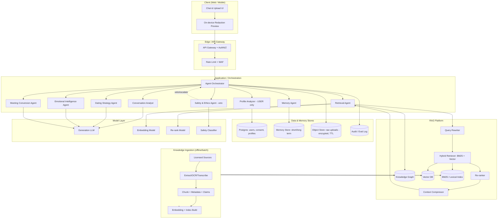
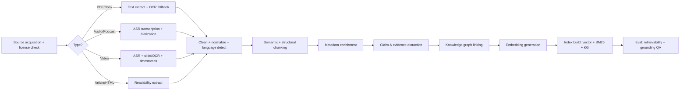
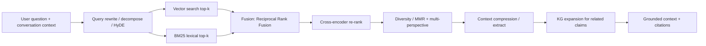
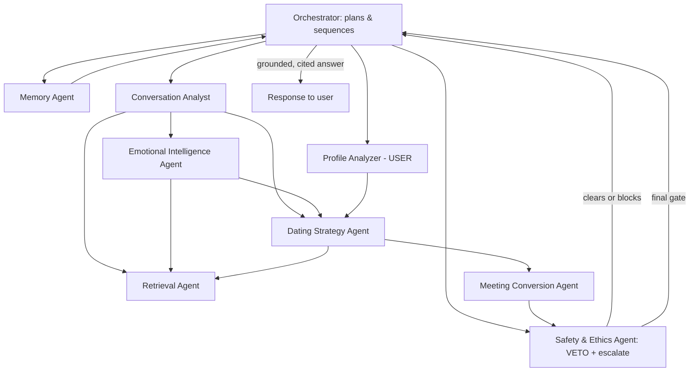
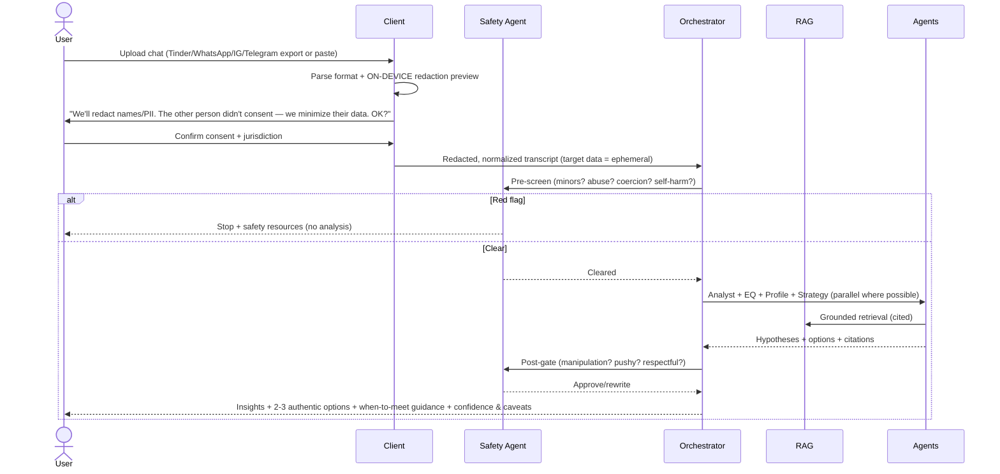
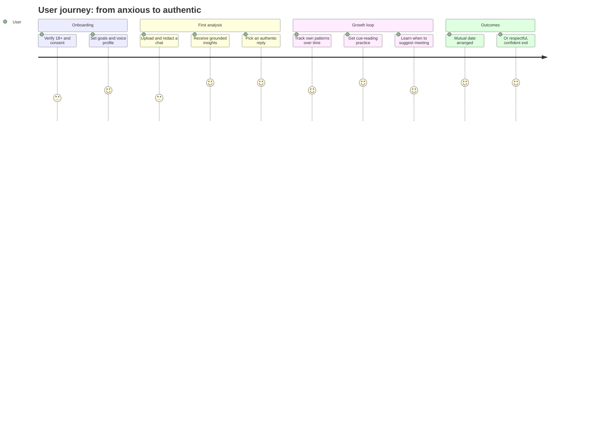
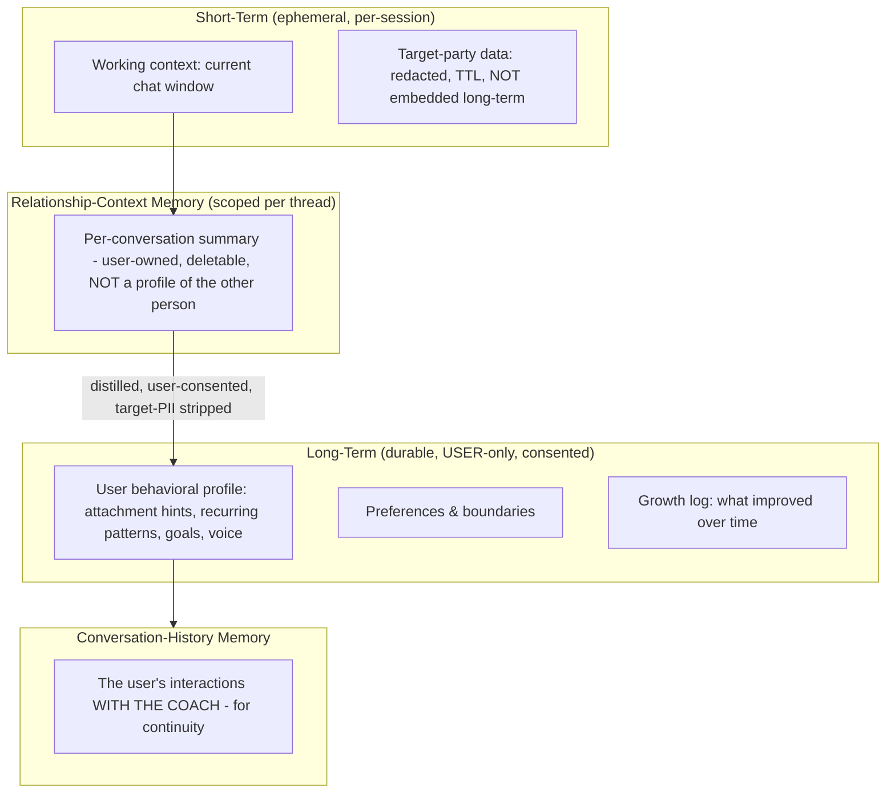

# Software Architecture Document (SAD)
## "Bridge" — A RAG-Based Communication Coach for Dating Conversations

**Document status:** Draft v0.9 (design only — no implementation)
**Author role:** Principal Architect / Product Strategist / RAG Engineer / Relationship-Psychology Reviewer
**Date:** 2026-06-25

---

## 0. Read This First — Challenges, Hidden Risks & Honest Reframes

You asked me to *challenge assumptions before designing*. I'm doing that here, up front, because several of these conclusions reshape the entire architecture. If I skipped straight to vector databases I'd be building the wrong product well.

### 0.1 The four assumptions that need challenging

| # | Stated assumption | Challenge | Consequence for design |
|---|-------------------|-----------|------------------------|
| A1 | "The user uploads the chat and we analyze it." | The chat contains a **second person who never consented** to being psychologically profiled by an AI. This is the single biggest legal/ethical fault line in the product. | We must treat the other party as a **non-consenting data subject**, minimize their data, never build a persistent profile of *them*, and lean on jurisdictional consent rules (GDPR Art. 6/9, two-party consent states). |
| A2 | "Optimize for attraction / convert to a date." | A metric of "conversion to date" rewards persistence past disinterest. Optimizing that number *is* the manipulation you said you want to avoid. The metric and the ethics are in direct tension. | The north-star metric must be **mutual-fit + authenticity**, not raw conversion. We add an explicit "she's not interested — disengage" detector as a first-class output, not an edge case. |
| A3 | "Analyze attraction indicators / predict trajectory / detect emotional state." | Inferring a stranger's emotional state and attraction level from text is **low-validity**. The science (Gottman, attachment theory) is built on *bidirectional, longitudinal, observed* interaction — not one-sided text logs. Selling "attraction score: 73%" is pseudo-precision that users will over-trust. | We present signals as **hypotheses with confidence bands and counter-evidence**, never as scores-as-truth. Calibration and uncertainty become core eval metrics. |
| A4 | "RAG from Gottman, Perel, Cialdini, etc." | Most of this corpus is **copyrighted**. You cannot legally ingest full books into a commercial product and surface them. Also: *Cialdini is persuasion/compliance science* — using it to influence a romantic partner is precisely the manipulation vector you disclaimed. | Knowledge base must be built on **licensed, public-domain, open-access, or first-party-licensed** content. Cialdini-style material is used for *defensive* literacy ("are you being pressured?") and self-awareness, not for scripting influence. |

### 0.2 Hidden risks (ranked)

1. **Regulatory / consent** — uploading a third party's private messages. *Highest severity.*
2. **Copyright** — ingesting books/courses/paid content into a commercial retrieval system.
3. **Manipulation framing** — the product can trivially become a "pickup-artist scripting engine," which is reputationally and ethically toxic and likely to get app-store-banned and payment-processor-flagged.
4. **Psychological harm to the user** — over-reliance, deskilling, anxiety from "scores," parasocial dependence on the AI.
5. **Harm to the other party** — being love-bombed, manipulated, or pursued past clear disinterest.
6. **Safety** — the system must detect when the *user* is the one being coercive, or when either party signals a safety risk (minors, abuse, self-harm, coercion).
7. **Bias** — relationship "norms" are heavily culturally and heteronormatively loaded; a model trained/retrieved on Western pop-psychology will misfire across cultures, orientations, and neurodivergent communication styles.
8. **Hallucinated authority** — citing "Gottman says…" for something Gottman never said is both a factual and a liability problem.

### 0.3 The reframe that makes this product defensible

> **From:** "An AI that helps you win dates by optimizing your messages."
> **To:** "A private communication *coach* that helps you understand your own patterns, communicate authentically, read social cues more accurately, respect boundaries, and decide when/how to move toward meeting in person — grounded in cited relationship science."

This reframe is not cosmetic. It changes the metrics (Phase 1), the agent design (a Safety/Ethics agent with veto power, Phase 4), the memory model (we profile *the user*, not the target — Phase 6), and the evaluation framework (calibration & harm-avoidance, not conversion-maximization — Phase 7).

I'll design the product you asked for, in the form that won't get you sued, banned, or ashamed of it.

---

## Phase 1 — Product Definition

### 1.1 Core problem
Many people struggle in early-stage dating communication: they misread interest, over- or under-invest, freeze on what to say, repeat self-sabotaging patterns, and either never convert good matches into real meetings or push past disinterest. Generic chatbots give generic, ungrounded, sometimes manipulative advice. There is no private, evidence-grounded coach that helps a person **understand their own communication and act with authenticity and respect.**

### 1.2 Target users
- **Primary:** Adults (verified 18+) who actively use dating apps and want to communicate more confidently and authentically.
- **Secondary:** People re-entering dating (post-divorce, post-long-relationship) who feel out of practice.
- **Tertiary (later):** Coaches/therapists who want a structured tool to review (with client consent) communication patterns.

### 1.3 Personas
| Persona | Goal | Pain | What "success" looks like for them |
|---|---|---|---|
| **Anxious Avi (29)** | Stop over-analyzing every message | Sends 5 drafts, deletes them, spirals | Sends one authentic message, feels calm, learns it's okay |
| **Direct Dana (34)** | Convert good matches to dates faster | Conversations stall in small talk | Knows *when* and *how* to suggest meeting; reads a "no" gracefully |
| **Returning Roni (45)** | Relearn modern dating norms | Feels the "rules" changed | Understands current etiquette; rebuilds confidence |
| **Cue-blind Sam (26, ND)** | Read subtext they genuinely miss | Misses disinterest or interest signals | Gets explicit, non-judgmental decoding of ambiguous messages |

> Note Sam: neurodivergent users are a *core* use case, not an edge case. The product's value of "make implicit social cues explicit" is genuinely assistive — and a strong, defensible positioning.

### 1.4 Success metrics (north-star and guardrails)
**North-star:** *User-reported authentic-confidence* + *healthy-outcome rate* — a composite of (a) self-reported confidence/anxiety reduction, (b) conversations that reached a mutually-agreed meeting **or** a clean, respectful disengagement.

| Category | Metric | Why this (and not the obvious one) |
|---|---|---|
| Value | Confidence delta (validated short survey, weekly) | Measures the real benefit without rewarding manipulation |
| Healthy outcome | % conversations ending in *mutual* meeting **or** respectful close | Counts a graceful "this isn't a match" as a **win**, not a failure |
| Cue accuracy | User-confirmed accuracy of cue readings | Directly measures core value & calibration |
| Engagement (guardrail, not goal) | Sessions/week, capped-concern flag if too high | High usage may indicate dependence/anxiety — watch, don't maximize |
| Safety | % flagged conversations correctly routed | Detects coercion/minors/self-harm |
| Trust | Citation-grounded answer rate; "advice felt manipulative" complaint rate | Keeps the product on the right side of the line |

**Anti-metrics (explicitly NOT optimized):** raw date-conversion rate, message volume, time-in-app, "attraction score" inflation.

### 1.5 Ethical boundaries (hard rules, enforced by the Safety & Ethics agent)
- No deception scripting (no fake personas, no "negging," no manufactured scarcity, no love-bombing playbooks).
- No coaching to pursue someone showing disinterest or saying no.
- No persistent psychological profiling of the *other* party.
- No advice that pressures, isolates, or manipulates.
- Hard stops + resources for: indications of a minor, intimate-partner abuse, coercion, self-harm, sexual content involving non-consent.
- Always disclose AI limitations and the low validity of text-only inference.

### 1.6 Risks (and mitigations)
| Risk | Severity | Likelihood | Mitigation |
|---|---|---|---|
| Third-party consent / privacy law | High | High | Data minimization, redaction-by-default, consent gating, jurisdiction rules, ephemeral target data |
| Copyright on knowledge base | High | High | License-first ingestion (see Phase 3) |
| "PUA tool" perception → app-store/payment ban | High | Med | Product framing, Safety agent, refusal of manipulation requests, public ethics page |
| Pseudo-precision / over-trust | Med | High | Confidence bands, counter-evidence, calibration eval |
| Cultural/orientation/ND bias | Med | High | Diverse corpus, configurable norms, "this is one framework" framing |
| Psychological dependence | Med | Med | Usage nudges, "you've got this — here's why" handoffs, no dark-pattern retention |
| Hallucinated citations | Med | Med | Strict grounded-generation + citation verification (Phase 7/10) |

### 1.7 Competitive landscape
| Category | Examples (illustrative) | Gap we exploit |
|---|---|---|
| AI "rizz"/reply generators | Various app-store apps | Ungrounded, manipulation-leaning, no self-insight, privacy-careless |
| General LLM chat | ChatGPT/Claude direct | No grounding, no memory of *your* patterns, no safety scaffolding for this domain |
| Human coaching/therapy | Dating coaches, therapists | Expensive, not real-time, variable quality |
| Relationship apps | Journaling/relationship-health apps | Aimed at existing couples, not early-stage cue-reading |

**Our wedge:** *evidence-grounded, privacy-first, self-insight-oriented* coaching — the trustworthy option in a sketchy category.

---

## Phase 2 — System Architecture

### 2.1 High-level architecture

### 2.2 Component responsibilities (summary)
| Layer | Component | Responsibility |
|---|---|---|
| Client | Upload + on-device redaction | Capture chat; redact names/PII *before* it leaves the device where possible |
| Edge | Gateway, WAF, rate limit | AuthN/Z, abuse prevention, regional routing for data residency |
| Orchestration | Agent Orchestrator | Plan → call agents → enforce Safety veto → assemble answer |
| RAG | Retrieval pipeline | Query rewrite → hybrid search → re-rank → compress → ground |
| Data | Stores | Durable user state; *ephemeral* target/raw chat data |
| Ingestion | Offline ETL | Build the knowledge base from licensed sources |
| Models | LLMs/embedders | Generation, embedding, re-ranking, safety classification |

### 2.3 Key cross-cutting decisions (justified)
- **Orchestrator-with-veto over a free-for-all agent swarm.** Deterministic control flow + a Safety agent that can hard-stop is auditable and safer than emergent multi-agent chatter. (Justification: in a safety-critical, regulated domain, *predictability* beats cleverness.)
- **Ephemeral target data, durable user model.** The architecture physically separates "the other person's words" (short TTL, encrypted, never embedded into long-term profiles) from "the user's own patterns" (durable, consented). This single split resolves most of Phase 0's privacy risk.
- **RAG as a platform, not a feature.** Retrieval is shared infrastructure consumed by multiple agents, so grounding/citation/eval are enforced in one place.

---

## Phase 3 — RAG Design

### 3.1 Knowledge sources — *license-first*

The hard rule (from Phase 0): **we do not ingest content we don't have the right to use.** Concretely, the corpus is built, in priority order, from:

| Tier | Source type | Examples | Acquisition |
|---|---|---|---|
| 1 | Open-access scientific literature | PubMed Central OA, PsyArXiv, open APA/PSPB articles, Google Scholar OA | Direct download under OA licenses |
| 2 | Public-domain & CC works | Older psychology texts, government health resources | Public domain / CC |
| 3 | First-party licensed | Licensing deals with specific authors/publishers; expert interviews recorded *for us* with signed release | Contracts |
| 4 | Owned/commissioned | Content we write & have reviewed by credentialed clinicians | First-party |
| 5 | Public web (summary/citation only) | Reputable articles, public talks | Store **citations + short quotes** under fair-use limits; link out, don't host full text |

> For "Gottman / Perel / Cialdini / Brown / Kahneman / Voss": we ingest **only** their open-access papers, public talks (transcript + citation), and any *licensed* material. Where we lack rights, the system *cites and links* rather than reproducing. The concepts (e.g., Gottman's "bids for connection," Kahneman's System 1/2, attachment styles) are facts/ideas we can describe in our own commissioned, clinician-reviewed explainers.

**Additional authoritative experts worth licensing/citing:** Sue Johnson (EFT/attachment), Amir Levine & Rachel Heller (*Attached*), Harry Reis & Arthur Aron (intimacy/closeness research, the "36 questions"), Eli Finkel (relationship science / online dating), Helen Fisher (attraction neuroscience), Marshall Rosenberg (Nonviolent Communication), Paul Ekman (affect — with heavy caveats on text), Carol Dweck (mindset), Kristin Neff (self-compassion).

### 3.2 Data processing pipeline

**Stage notes & justifications:**
- **Extraction/OCR** — books/PDFs need layout-aware extraction; OCR (e.g., Tesseract / a vision model) only as fallback for scans. *Why:* clean text quality dominates downstream retrieval quality (garbage in → garbage retrieved).
- **Transcription** — Whisper-class ASR with speaker diarization for podcasts/interviews; keep timestamps so citations can deep-link to the moment. *Why:* a huge share of expert content is audio/video; timestamped citation is a trust feature.
- **Chunking** — *structure-aware + semantic* chunking (respect headings, Q&A turns, paragraph/idea boundaries), target ~300–600 tokens with overlap, plus **parent-document / small-to-big** retrieval (retrieve small, expand to parent for context). *Why:* fixed-size chunks split ideas mid-thought and hurt both recall and grounding.
- **Metadata enrichment** — author, credentials, source type, publication year, study design & sample size (for papers), modality, topic tags, *evidence-strength rating*. *Why:* lets retrieval prefer high-evidence sources and lets the UI show "peer-reviewed RCT" vs "podcast opinion."
- **Claim & evidence extraction** — convert content into atomic, attributable claims ("X correlated with Y, r=…, n=…, study type…"). *Why:* enables citation-grounded answers and contradiction detection.
- **Knowledge graph** — link claims ↔ concepts ↔ experts ↔ studies; model *agreements and contradictions* (Gottman vs Perel will disagree — that's signal, not noise). *Why:* lets the system present balanced, multi-perspective guidance and avoid false consensus.
- **Embedding + indexing** — see Phase 8 for model choice; dual-write to vector + lexical + graph.

### 3.3 Retrieval layer

| Component | What it does | Why it's needed |
|---|---|---|
| **Query rewriting / decomposition / HyDE** | Turn messy user input + chat context into clean retrieval queries; split multi-part questions; optionally generate a hypothetical answer to embed | User questions are vague ("is she into me?"); raw queries retrieve poorly |
| **Semantic (vector) search** | Dense retrieval for meaning/paraphrase | Catches conceptual matches lexical search misses |
| **BM25 (lexical)** | Exact-term/keyword matching | Catches names, jargon, specific techniques that embeddings blur |
| **Hybrid fusion (RRF)** | Combine both ranked lists | Dense+sparse consistently beats either alone; robust to query type |
| **Re-ranking (cross-encoder)** | Precisely score query–chunk relevance on the top ~50 | First-stage recall is noisy; re-rank sharply improves precision@k |
| **Diversity / multi-perspective (MMR)** | Avoid 5 chunks saying the same thing; ensure contrasting expert views | Prevents false consensus & echo; surfaces disagreements |
| **Context compression** | Extract only the relevant sentences | Cuts tokens/cost and reduces distraction → less hallucination |
| **KG expansion** | Pull linked claims/contradictions | Enables balanced, well-grounded answers |

**Why this is overkill-by-design:** in a high-trust domain, retrieval precision and balanced sourcing matter more than latency. We accept ~extra hundreds of ms for re-ranking + compression to buy grounding quality. (We cache aggressively — Phase 10 — to claw latency back.)

---

## Phase 4 — Multi-Agent Design

### 4.1 Topology

### 4.2 Responsibilities & interactions
| Agent | Owns | Inputs | Outputs | Notable rule |
|---|---|---|---|---|
| **Orchestrator** | Plan & control flow | User request, state | Task graph, final assembly | Deterministic; logs every step |
| **Safety & Ethics** | Hard rules | Everything, twice (pre & post) | Allow / block / escalate / rewrite | **Veto power** — can override any other agent |
| **Retrieval** | Grounding | Rewritten queries | Cited context | All claims must trace to a source |
| **Memory** | Continuity | User id, session | User profile + relevant history | Never loads target's persistent profile (none exists) |
| **Conversation Analyst** | Read the thread | Redacted chat | Strengths, mistakes, dynamics, *hypotheses w/ confidence* | No "scores as truth" |
| **Emotional Intelligence** | Affect & empathy | Chat + analysis | Likely emotional reads + counter-evidence; suggests empathetic framings | Always includes "could also mean…" |
| **Profile Analyzer (USER)** | The user's patterns | History across sessions | Attachment-style hints, recurring self-sabotage, growth areas | Profiles **only the user**, with consent |
| **Dating Strategy** | Next-step options | All above + retrieval | 2–3 *authentic* response options + reasoning + citations | Offers options, not a single "winning line" |
| **Meeting Conversion** | The ask | Trajectory + signals | *If signals are mutual:* timing & framing for inviting to meet; *if not:* recommend patience or graceful exit | Refuses to push past disinterest |

**Interaction guarantees:**
- Safety runs **pre** (sanitize input, detect red flags) **and post** (final gate on any outgoing suggestion).
- No agent emits an unsourced claim of fact; "in my experience"-style fabrication is disallowed.
- Disagreement between Analyst/EQ (e.g., conflicting reads) is **surfaced to the user**, not silently resolved.

### 4.3 Why multi-agent (vs one big prompt)
Separation of concerns gives us: independently testable components, a Safety agent with real veto authority, the ability to swap models per role (cheap model for routing, strong model for the empathy/strategy reasoning), and clearer audit logs. The cost is orchestration complexity and latency — mitigated by running independent agents in parallel and caching retrieval.

---

## Phase 5 — User Workflow

### 5.1 Upload & consent flow

### 5.2 What the analysis returns (reframed from your list)
| You asked for | What we actually deliver (defensible version) |
|---|---|
| Identifies strengths | ✅ "Here's what worked and why (cited)" |
| Identifies mistakes | ✅ "Patterns that may be undercutting you" — framed as *your* growth, not blame |
| Attraction indicators | ⚠️ "Interest *signals* — hypotheses with confidence + counter-evidence," never a single % truth |
| Emotional state | ⚠️ "Possible emotional reads + alternatives" with explicit low-confidence disclaimer |
| Predicts trajectory | ⚠️ "Plausible directions" as scenarios, not a forecast number |
| Suggests next messages | ✅ 2–3 authentic options in *the user's voice*, with reasoning |
| Recommends timing | ✅ General guidance, not manipulative "wait 3 hours to seem busy" games |
| Date invitation strategy | ✅ *Only when signals are mutual*; otherwise advises patience or a graceful exit |

### 5.3 User journey (lifecycle)

---

## Phase 6 — Memory System

### 6.1 The defining constraint
**We build a durable model of the user. We do NOT build a durable model of the other person.** Target data is short-term, scoped to the active analysis, encrypted, and TTL-deleted. This is the architectural expression of Phase 0's consent ethic.

### 6.2 Memory tiers

| Tier | Stores | Lifetime | Storage | Retrieval |
|---|---|---|---|---|
| Short-term / working | Current chat window, transient reasoning | Session / minutes | In-memory + encrypted cache | Direct context injection |
| Target-party data | Redacted other-person messages | Short TTL (e.g., auto-purge) | Encrypted object store, no long-term embedding | Loaded only during active analysis |
| User behavioral profile | Attachment-style *hints*, self-sabotage patterns, goals, "voice" | Durable (until user deletes) | Postgres + vectorized summaries | Semantic + key lookup by Memory Agent |
| Relationship-context (per thread) | A *user-owned* summary of a given pursuit | User-controlled | Postgres | Loaded when user revisits that thread |
| Coach-conversation history | The user's dialogue with the app | Durable | Append log + summaries | Recency + semantic recall |

### 6.3 Storage & retrieval mechanics
- **Write path:** raw → redaction → summarize → extract user-pattern signals → (consented) merge into user profile; target PII never reaches the durable layer.
- **Read path:** Memory Agent does hybrid recall (recent + semantically relevant + profile facts) and injects a compact, token-budgeted memory block.
- **Forgetting:** explicit user "delete this thread / delete everything," automatic TTL on target data, and periodic profile re-summarization to prevent unbounded growth.
- **Why summaries over raw logs in LTM:** privacy (less raw PII at rest), cost, and retrieval quality (distilled patterns retrieve better than transcripts).

---

## Phase 7 — AI Evaluation

### 7.1 Metric stack
| Layer | Metrics | Tooling approach |
|---|---|---|
| Retrieval | Recall@k, Precision@k, MRR, nDCG, hit-rate; **context relevance** | Golden Q→passage set; offline harness |
| Grounding / faithfulness | Faithfulness (claims supported by context), **citation accuracy** (does cited source actually say it), context-precision/recall | LLM-as-judge + human spot audit + RAGAS-style metrics |
| Generation quality | Helpfulness, empathy, clarity, *authenticity-to-user-voice* | Rubric + human + LLM judge |
| **Calibration** | Are confidence bands honest? (predicted-vs-actual when user later confirms) | Reliability diagrams, Brier score |
| Safety | Red-flag detection recall (minors/abuse/self-harm/coercion), manipulation-refusal rate, false-block rate | Adversarial red-team set |
| Outcome (north-star) | Confidence delta, healthy-outcome rate, cue-accuracy (user-confirmed) | In-product surveys + opt-in outcome reporting |
| Anti-metrics watch | Dependence signals, "felt manipulative" complaints | Monitoring dashboards |

### 7.2 Human evaluation framework
- **Expert panel:** licensed therapists / relationship scientists score a sampled set on accuracy, ethics, and harm-avoidance (rubric, blind, inter-rater reliability tracked).
- **User panel:** real users confirm cue-reading accuracy ("did this match what actually happened?").
- **Red team:** adversarial testers try to make it produce manipulation/PUA/coercive output; pass criterion = refuses + reframes.

### 7.3 A/B testing methodology
- Randomized, opt-in, **ethics-reviewed** experiments. Primary metric = north-star (authentic confidence + healthy outcome), **not** conversion.
- Guardrail metrics that auto-halt an experiment: increase in "felt manipulative," safety false-negatives, or dependence signals.
- Sequential testing with pre-registered hypotheses; never silently optimize a dark pattern.

---

## Phase 8 — Tech Stack Selection

> Versions intentionally omitted (they move fast). Choose latest stable at build time. For any model/library specifics, validate against current docs.

### 8.1 LLMs (generation)
| Option | Pros | Cons | Verdict |
|---|---|---|---|
| **Claude (Opus/Sonnet class)** | Strong reasoning, nuance, safety steerability, long context — ideal for empathy + grounded reasoning | Cost at top tier | **Primary** for empathy/strategy/EQ reasoning |
| Mid/cheap tier (Sonnet/Haiku class) | Fast, cheap | Less nuance | Routing, classification, summarization |
| Open-weight (Llama/Mistral/Qwen class) | Self-host, data control, cost | Ops burden, quality gap on nuance | Optional for PII-sensitive on-prem path or cost control |

**Decision:** tiered — small model for routing/safety-classification/summary; frontier model (Claude Opus-class) for the user-facing empathy/strategy generation where nuance and safety matter most. Validate exact current model IDs/pricing against the Claude API reference before building.

### 8.2 Embeddings
| Option | Notes |
|---|---|
| Hosted embedding API (OpenAI/Voyage/Cohere-class) | High quality, zero ops; check data-handling terms |
| Open (e5 / BGE / GTE / Nomic-class) | Self-hostable, good quality, data stays in-house |

**Decision:** start hosted for quality/speed; keep an open model as a self-host fallback for the privacy-sensitive path. Add a **domain re-ranker** (cross-encoder, e.g., Cohere Rerank-class or open BGE-reranker).

### 8.3 Vector database
| Option | Pros | Cons | Fit |
|---|---|---|---|
| **pgvector (Postgres)** | One database for app + vectors + metadata; transactional; simple ops; hybrid via pg full-text | Scales to ~low-millions of vectors comfortably, then needs care | **MVP default** — fewer moving parts |
| Qdrant | Great hybrid, payload filters, open-source, self-host or cloud | Another service | **V2 scale path** |
| Weaviate | Built-in hybrid + modules | Heavier | Alt to Qdrant |
| Milvus | Massive scale | Ops-heavy | Enterprise scale |
| Pinecone | Fully managed, easy | Cost, vendor lock-in | If you want zero infra |

**Decision:** **pgvector for MVP** (it also stores users/consent/profiles — one source of truth), migrate the knowledge index to **Qdrant** at scale. Lexical/BM25 via Postgres FTS (MVP) → OpenSearch/Elasticsearch (scale).

### 8.4 Backend
| Option | Notes |
|---|---|
| **Python + FastAPI** | Best AI/ML ecosystem, async, fits orchestration & ingestion | **Recommended** |
| Node/TS (NestJS) | Great if frontend team is JS-heavy | Viable |
| Orchestration | LangGraph / LlamaIndex / custom — **prefer a thin, explicit orchestrator** you control over heavy framework magic, given the safety-critical veto logic |

### 8.5 Frontend
- **Next.js (React) + TypeScript**, with streaming UI for responses; on-device redaction in the client. React Native / Expo for mobile sharing the design system. *Why:* SSR/streaming, large ecosystem, easy share-targets for chat imports.

### 8.6 Cloud & infra
- Containerized (Docker) on managed Kubernetes or a serverless-container platform; **regional deployments for data residency** (EU users' data stays in EU).
- Object store (encrypted, lifecycle TTL) for raw uploads; managed Postgres; managed cache (Redis) for sessions + retrieval cache.
- Queue (e.g., SQS/PubSub) for the async ingestion pipeline.

### 8.7 Monitoring / observability
- **LLM observability:** Langfuse / Arize Phoenix / LangSmith-class — trace every retrieval + generation, log token cost, capture eval scores online.
- **App/infra:** OpenTelemetry → Grafana/Prometheus; Sentry for errors.
- **Safety dashboards:** red-flag rates, manipulation-refusal rate, "felt manipulative" complaints, calibration drift.

---

## Phase 9 — MVP → Enterprise Roadmap

| Version | Features | Architecture | Indicative cost driver | Key risks |
|---|---|---|---|---|
| **MVP** | Paste/upload + redact one chat; single-pass Analyst + EQ + Strategy; basic grounded RAG over a *small licensed corpus*; Safety agent (rules + classifier); user accounts + consent; 2–3 reply options w/ citations | Monolith FastAPI; **pgvector** (vectors+app data); hosted LLM/embeddings; Redis cache | Frontier-LLM calls; ingestion labor | Getting consent/redaction right; corpus licensing; avoiding "PUA tool" framing |
| **V2** | Full multi-agent orchestration; user behavioral profile + memory; hybrid+re-rank+compression; knowledge graph; calibration & confidence UI; mobile app + share-target import; richer corpus | Split services; **Qdrant** + OpenSearch BM25; LLM observability; A/B framework | Re-ranking + bigger corpus + storage | Scaling retrieval quality; privacy at larger data volume |
| **V3** | Multi-perspective answers (surfaced expert disagreement); per-thread relationship-context memory; ND/orientation/culture configurability; outcome-tracking loop; fine-tuned small models for routing/safety | Multi-region; feature store; eval CI gates; partial open-model self-host for PII path | Multi-region infra; model training | Bias/fairness across cultures; dependence monitoring |
| **Enterprise** | Coach/therapist console (with client consent); white-label; compliance certifications; SSO; data-residency guarantees; SLA | Full microservices; dedicated tenancy; on-prem/VPC deploy option | Compliance + dedicated infra + support | Regulatory (health-adjacent), liability, audit |

> Note on costs: I'm deliberately not quoting dollar figures — token prices, infra, and licensing terms vary too much and date quickly. Build the cost model from *current* Claude API pricing + your retrieval token budget + licensing quotes at build time.

---

## Phase 10 — Production Readiness

### 10.1 Scalability
- Stateless services behind autoscaling; retrieval/result **caching** (semantic cache for repeated questions) to cut LLM cost & latency.
- Async ingestion pipeline decoupled via queues; index builds are batch jobs.
- Separate read paths: hot user-facing path vs heavy offline eval/ingestion.

### 10.2 Security
- Encryption in transit (TLS) and at rest; per-tenant key separation; secrets in a vault.
- Strict authZ; the Safety agent and audit log are tamper-evident.
- Threat-model the upload path (malicious files, injection via chat content → **prompt-injection defenses**: treat all uploaded chat as untrusted data, never as instructions).

### 10.3 Privacy & compliance
- **Consent-first** (Phase 0): explicit, jurisdiction-aware, with third-party-data minimization.
- Data minimization, redaction-by-default, short TTL on target data, user-controlled deletion (GDPR/CCPA DSAR support).
- Data residency per region; DPA with subprocessors; clear privacy policy + ethics page.
- Likely **not** HIPAA (we're coaching, not therapy) — but design *toward* health-grade handling and **clearly disclaim that this is not therapy/medical advice**, with crisis resources wired in.

### 10.4 Hallucination prevention
- Retrieval-grounded generation with **citation-required** outputs; the Safety/grounding gate rejects unsourced factual claims.
- Context compression to reduce distractor-induced hallucination; KG-based contradiction checks.
- Citation **verification** step (does the cited passage actually support the claim?) in eval and, for high-stakes claims, inline.
- Explicit "I'm not sure / low confidence" pathways instead of confident fabrication.

### 10.5 RAG evaluation in production
- Online eval sampling: faithfulness, context-relevance, citation-accuracy scored continuously (LLM-judge + human audit).
- **Eval gates in CI:** corpus or prompt changes must pass the golden set before deploy.
- Drift monitoring on retrieval quality and calibration.

### 10.6 Human feedback loops
- Lightweight inline feedback ("was this accurate?", "did this feel respectful?").
- Outcome opt-in ("what actually happened?") feeding calibration.
- Expert review queue for flagged/low-confidence/edge cases; their corrections become training/eval data.
- Closed loop: feedback → eval set → prompt/retrieval/model improvements → A/B → ship.

### 10.7 Cost optimization
- Model tiering (cheap for routing/summary, frontier for user-facing nuance).
- Semantic + exact caching; context compression to shrink prompt tokens; prompt caching for stable system/context blocks.
- Batch + off-peak for ingestion/eval; right-size embedding dimensions.

---

## Appendix A — Architectural Decisions (ADR-style summary)
| ID | Decision | Rationale | Alternative rejected |
|---|---|---|---|
| ADR-1 | Profile the user, not the target; target data ephemeral | Resolves third-party consent risk | Symmetric profiling (legal/ethical landmine) |
| ADR-2 | North-star = authentic confidence + healthy outcome | Conversion metric rewards manipulation | Date-conversion maximization |
| ADR-3 | License-first corpus | Copyright exposure | Scrape books/courses |
| ADR-4 | Orchestrator + Safety veto | Auditable, safe control flow | Emergent agent swarm |
| ADR-5 | pgvector → Qdrant migration path | Simple MVP, scale later | Premature managed vector DB |
| ADR-6 | Confidence bands + counter-evidence, never scores-as-truth | Text inference is low-validity | "Attraction: 73%" UI |
| ADR-7 | Tiered models | Cost vs nuance | Single frontier model everywhere |

## Appendix B — Open questions to resolve before build
1. Which jurisdictions launch first? (Sets consent/residency requirements.)
2. Licensing: which experts/publishers will actually sign? (Determines corpus depth.)
3. Clinical oversight: who is the credentialed reviewer-of-record?
4. Orientation/relationship-structure scope at launch (hetero only? all? ethical non-monogamy?).
5. Crisis-escalation partnerships (which hotlines/resources per region)?

---

*End of SAD v0.9. No implementation code included by design. The most important sections are 0, 1.4–1.5, 4.2 (Safety veto), and 6.1 — they're what keep this product ethical, legal, and trustworthy at the scale of millions of users.*
